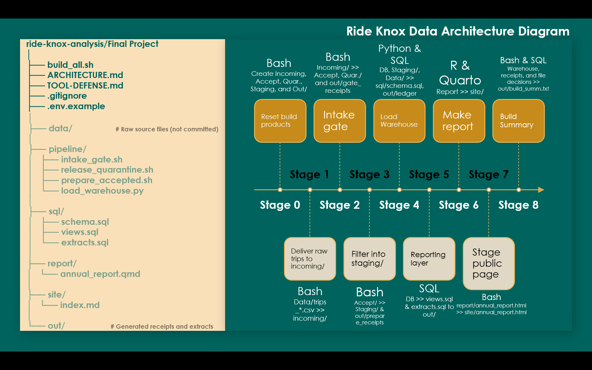

# Ride Knox Data Warehouse — System Architecture


## One-command build

The entire project is rebuilt by running:

```bash
bash build_all.sh
```

The build is organized into eight sequential stages. Each stage is timestamped, and a failure stops downstream processing.

## Architecture diagram



## Another way to view: Stage descriptions and handoffs

| Stage | Tool | Input | Output |
|---|---|---|---|
| 0. Reset | Bash | Existing build products | Clean working directories and database location |
| 1. Copy | Bash | `data/trips_*.csv` | Working copies in `incoming/` |
| 2. Intake | Bash | `incoming/` | `accepted/`, `quarantine/`, and gate receipts |
| 3. Prepare | Bash | `accepted/` | Repaired and filtered files in `staging/`, preparation receipts |
| 4. Load | Python and SQL | `staging/`, station files, weather file | SQLite warehouse and reconciliation ledger |
| 5. Reporting | SQLite and SQL | Warehouse database | Reporting views and CSV extracts in `out/` |
| 6. Render | Quarto and R | `report/annual_report.qmd`, reporting extracts | HTML report and supporting assets |
| 7. Publish staging | Bash | Rendered report and assets | Publication files in `site/` |
| 8. Summary | Bash and SQLite | Warehouse, receipts, and file decisions | `out/build_summary.txt` |