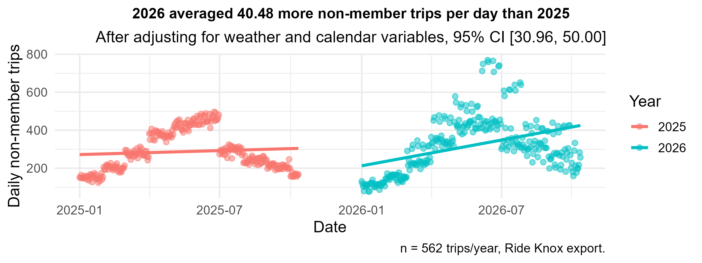

# Ride Knox: Two Years, One System

<!-- STARTER SKELETON. The front page of the public site, updated for the
     Final Project. TODO: your headline finding (the Integration Question
     verdict, with its range), your lead figure, and working links. -->

**The 2026 increase in non-member ridership (casual and day pass riders) appears to reflect a difference in demand that is explained partially by weather and calendar variables, since the estimated increase in ridership persists and grows from ~31 to ~40 trips per day after controlling for those variables. However, this cannot establish the cause.**

## Read the story

- **[The 2026 Annual Report](annual_report.html)** — Covers the two-year comparison picture, integration question analysis, cpacity changes over the two years, and the memo to the General Manager from this report. 

- To view the full 2025 report, please visit **[2025 Report](2025_report.md)**

- To view the full 2026 mid-year memo, please visit **[2026 Memo](2026_memo.md)**

- To view the full README, please visit **[README](../README.md)**
